# Astrion Custom (BæoRemote)

A native, high-performance Home Assistant dashboard and launcher for the **Sanytron Astrion HA100** smart remote, written from scratch to replace the stock `HaRemote` app.

It talks directly to Home Assistant over the standard WebSocket API, renders custom tactile Jetpack Compose UI across four dedicated hardware dashboards, and routes physical buttons with zero vendor cloud dependencies.

| BÆOVISION (TV) | BÆOREMOTE (Main) | BÆOSOUND (Media) | BÆOLIVING (Climate) |
|---|---|---|---|
| 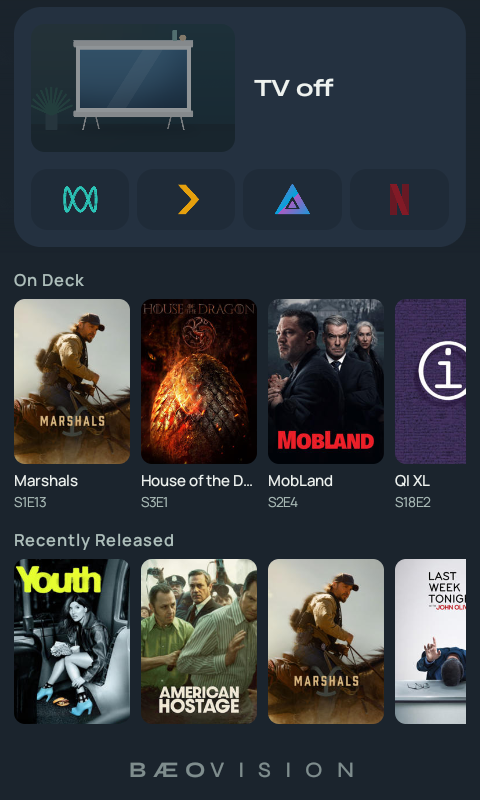 | 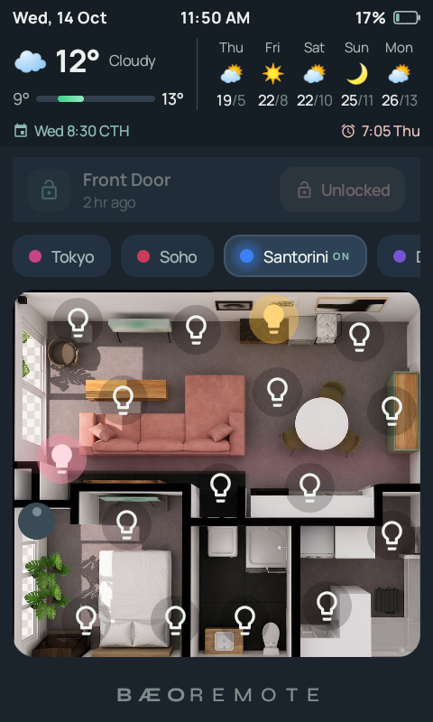 | 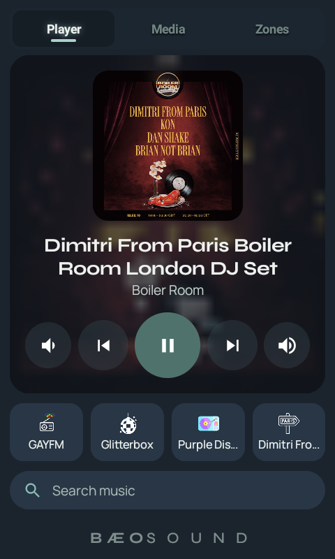 | 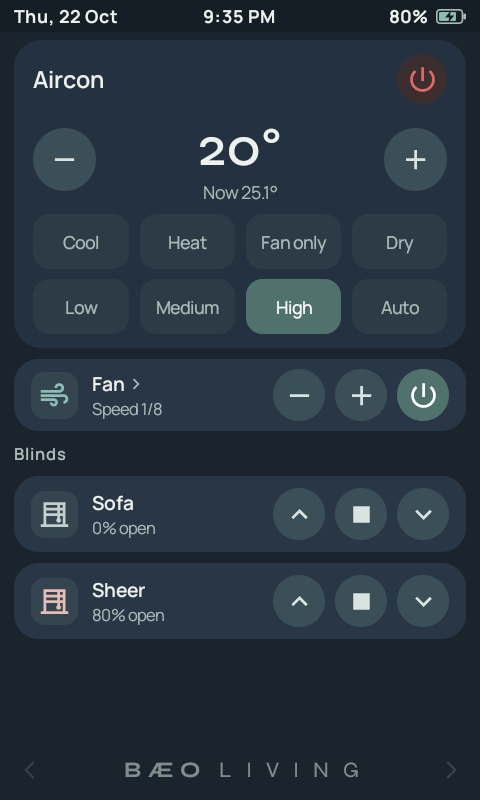 |

---

## The Four Dedicated Hardware Dashboards

The app is built around four primary pages, reachable with dedicated physical shortcut buttons (`CURTAIN`, `LIGHT`, `SCENE`, `AC`) and anchored by the signature fixed-width **BÆO** wordmark footer:

1. **BÆOVISION (`TV`):** What's on the TV, with **Search, Movies, TV and MTV** tiles inside the card that open your Plex server (search as you type, or full poster libraries with sort and watched ticks), a corner button that puts the TV's sound on the Sonos, and Plex shelves (*On Deck*, *Recently Released*…) where one tap wakes the TV, switches it to the Google TV and starts that exact episode or film.
2. **BÆOREMOTE (`Main`):** Weather, next alarm and event, a **Motion Lights** switch (pauses every motion and presence light automation so lights are manual only), a **mirror ball** that spins while it's on, the **Door** lock, labelled scene pills, and a live floorplan: each light drawn as its fixture (lamp, LED bar, artwork, candles…), TVs that glow while they're on, the robot vacuum and radar presence dots.
3. **BÆOSOUND (`Media`):** A **Search music** bar, the Club Sonos with its cover over a blurred wash, a volume fader and the queue, four mix shortcuts (GAYFM, Glitterbox…), search across everything in Music Assistant (library and Spotify), Music Assistant shelves, and the Zones tab for joining rooms and BÆOLINK.
4. **BÆOLIVING (`Climate`):** Air conditioning temperature steppers with target readouts, HVAC/fan modes, and motorized blind controls.

---

### BÆOSOUND (Multi-Room Media Stack)

The media dashboard features three dedicated tabs tailored for single-touch music management:

| Player (Now Playing) | Library | Queue | Media (Shelves & Playlists) | Zones (BÆOLINK Multi-Room) |
|---|---|---|---|---|
|  | 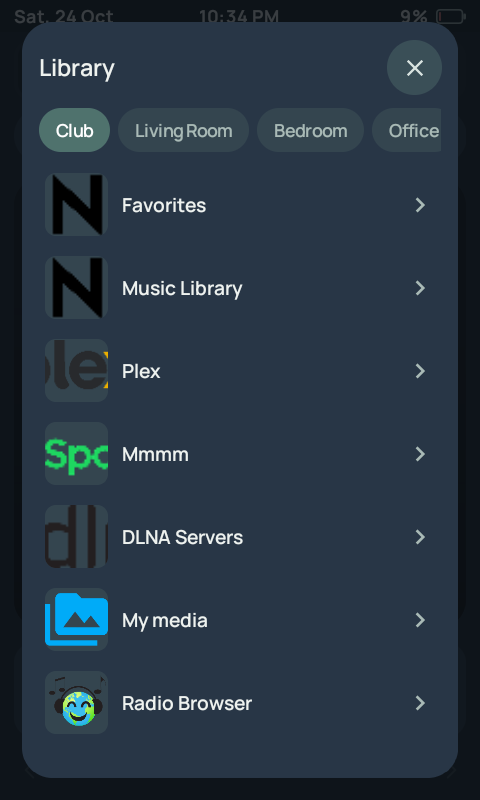 | 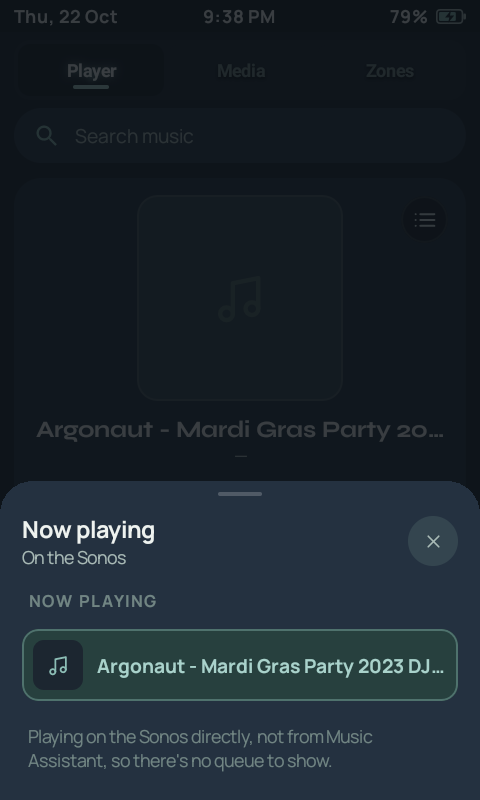 | 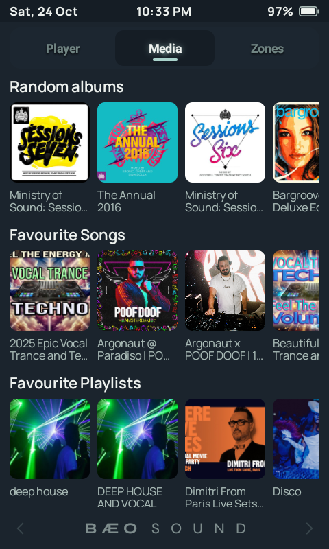 | 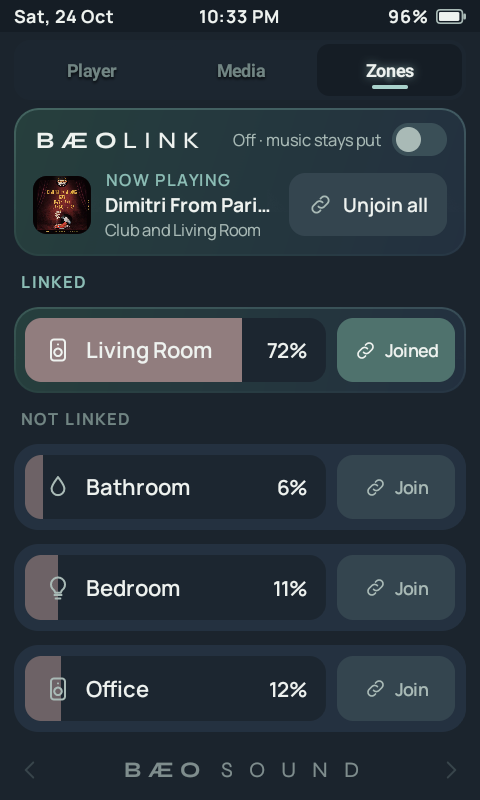 |

* **Player:** The Search music bar and the library button on top, then the cover over a blurred wash, transport controls, a volume fader with mute, and four one-touch mixes.
* **Library:** The round button beside Search music opens the Sonos library as HA's media browser shows it (favourites, music library, Plex, Spotify, radio) for any room: drill into folders, tap to play now or + to add to that room's queue.
* **Queue:** Now playing and up next from Music Assistant; when the Sonos is playing something Music Assistant didn't start (a favourite, the radio), its own track.
* **Media:** Music Assistant shelves: random albums from the local collection (Spotify's saved albums are kept out), favourite songs and playlists.
* **Zones:** Join or drop each room's speaker with its own volume; the **BÆOLINK** switch makes the music follow you from room to room.

### Search: music and Plex

| Music search | Plex search | Plex library | A show |
|---|---|---|---|
| 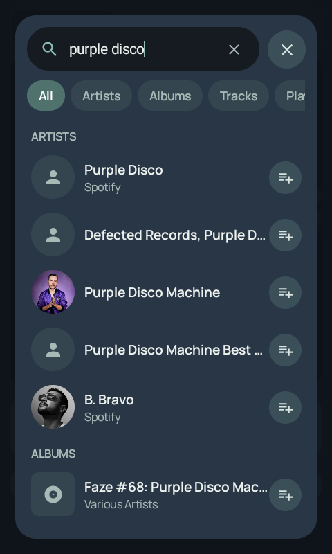 | 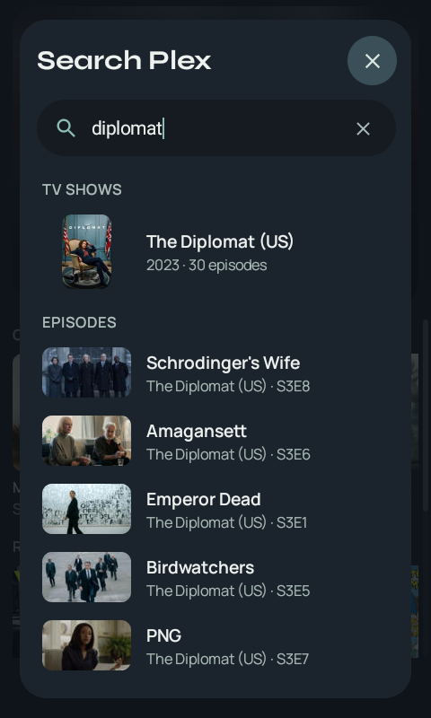 | 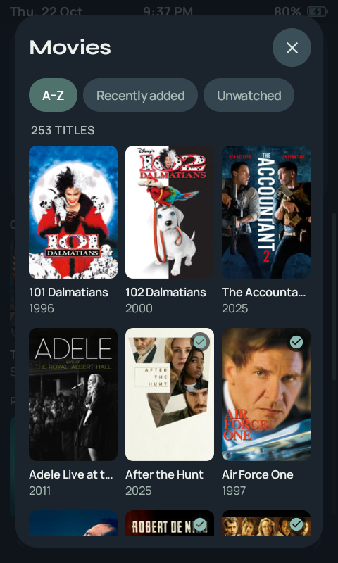 | 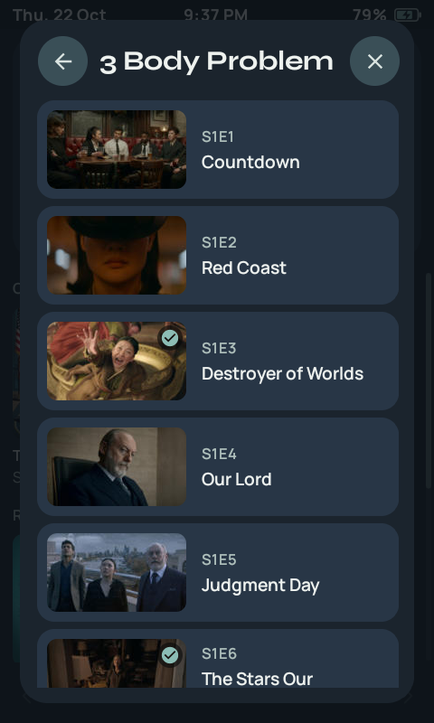 |

* **Music:** `music_search` card. Type an artist, album, song, playlist or station; results come from `music_assistant.search`, so every provider Music Assistant has is included. Tap to play now, **+** to queue.
* **Plex:** `plex_browse` card (here drawn inside the TV card as its `footer`). Search as you type, or open a whole library as a poster grid (A–Z, recently added, unwatched). Films play with one tap; a show opens to its seasons and episodes. Playback uses the same wake-the-TV + One Touch Play + Plex deep-link route as the shelves.

---

### Help guide (hold ☰)

| Guide | How do I… | On the TV |
|---|---|---|
|  | 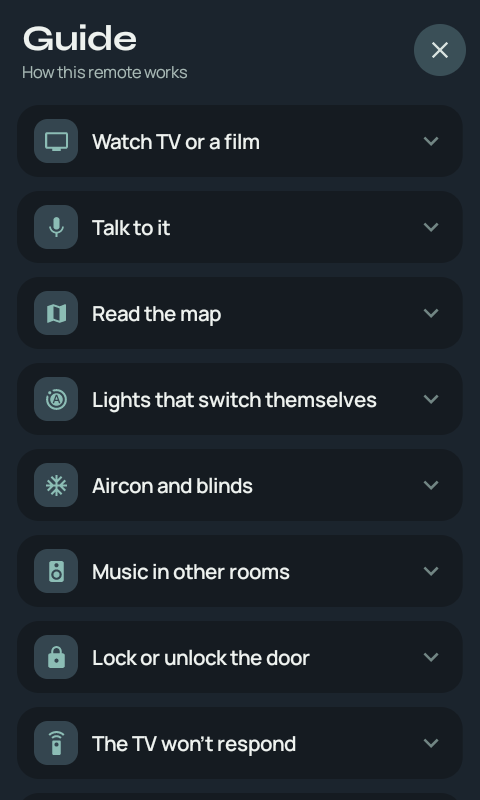 | 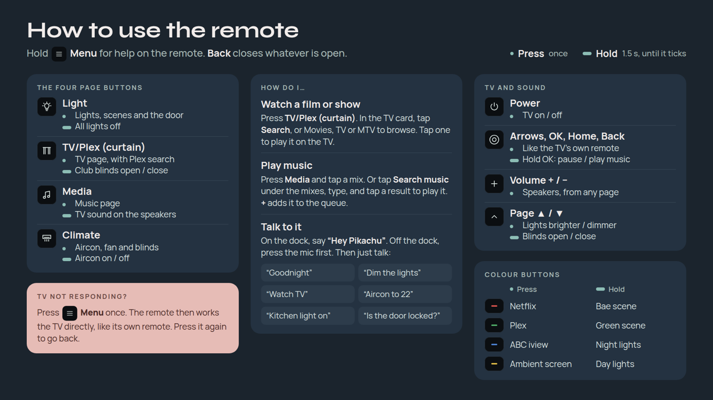 |

Holding **Menu ☰** opens a guide for anyone picking the remote up for the first time:

* **How do I…:** short answers that fold open, most-asked first (lights, music, finding a song, watching a film, talking to it, the floorplan, motion lights, other rooms, the door, a TV that won't respond).
* **Walkthrough:** asks for real presses on the real buttons, shows the button to find, and says what each one would have done. Nothing is sent to Home Assistant while the guide is open.
* **Every button:** what press and hold do for each button, read live from `dashboard.json` (a hotkey's optional `label` wins), with the real button glyphs.
* **On the TV:** the guide's `on_open` / `on_close` hooks put a one-page version on the Serif (via the Bæovision kiosk) and put the TV back afterwards.

---

### Dynamic Floorplan & LitRooms Lighting

The floorplan follows the sun and every light in the flat. As the sun drops, a shade darkens the plan, and each light that is on lifts it again with a pool of its own colour and brightness, so the plan looks like the room does.

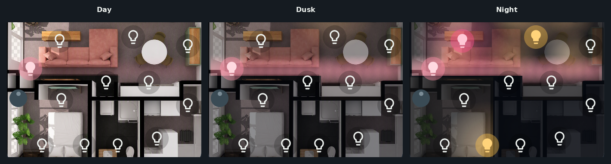

| Day | Dusk | Night |
|---|---|---|
| 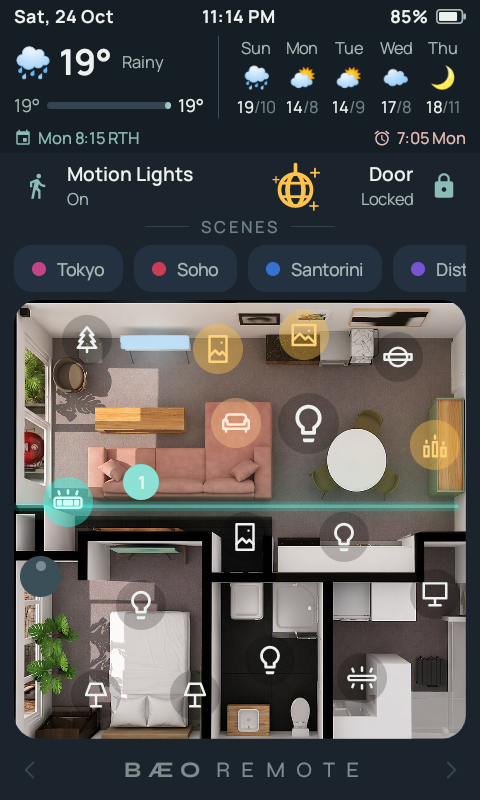 | 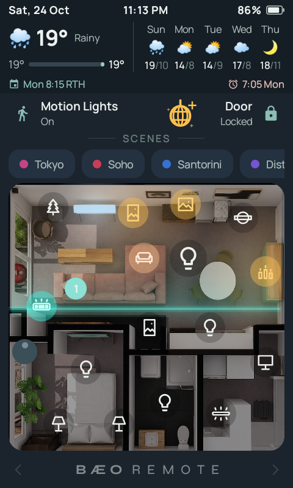 | 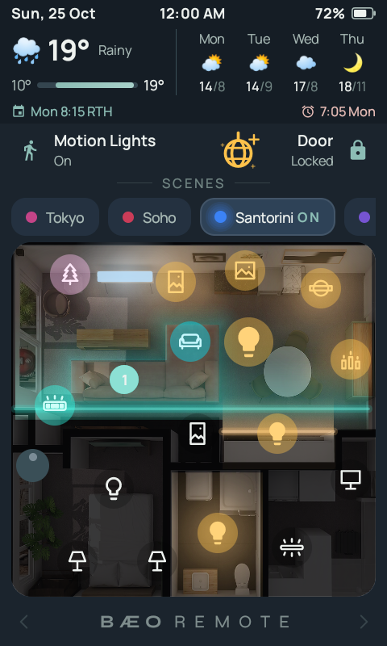 |

* **Sun-synced shading:** the shade eases in through civil twilight, from sun.sun's elevation. Light pools are faint by day and come up with the dark.
* **Lights as they look:** pools take each light's colour and brightness, with a hot core and a soft tail. The Club LED is a cove strip on a rail under the ceiling, so it draws as a dim rail with a wash of its colour spilling into the room (`glow_line`, `glow_toward`). Hidden strips halo what they sit under or behind (`glow_outline`): the sofa's underglow and the Hue Play bars round the TV. The kitchen strips light the counter.
* **Screens:** the TV lights up on the plan while it is on, including on the PC input (`also_on`).
* **Interactive Control:** Tap any bulb to toggle room lighting, or long-press to open the full-screen brightness and color tuning slider.
* **mmWave Radar Presence:** Real-time target tracking dots driven by LD2450 sensors plotted over the apartment layout.

---

## Screensavers & System Overlays

| Screensaver (Day) | Screensaver (Night) | Floating Volume OSD |
|---|---|---|
| 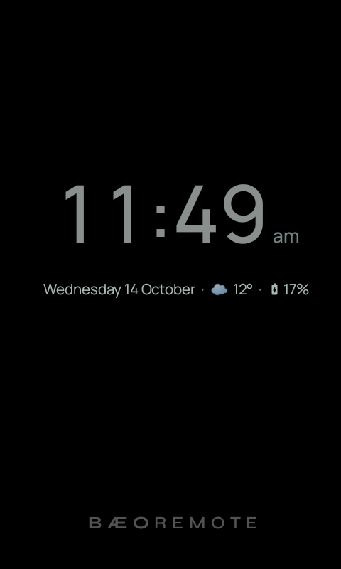 |  | 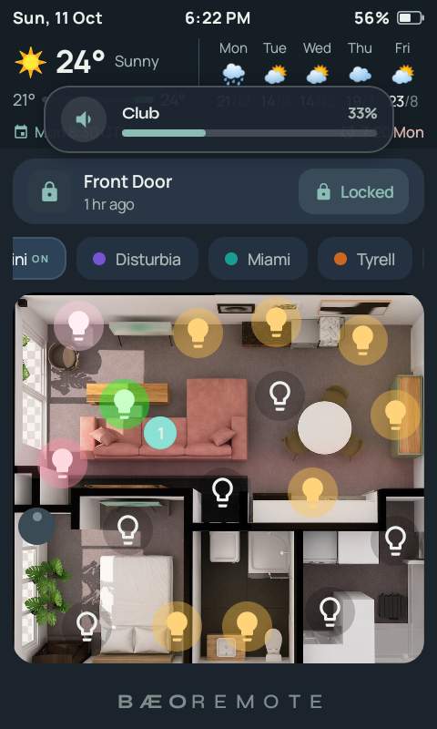 |

* **Contextual Screensavers:**
  * **Day Mode:** Crisp high-contrast mint and slate digits with live weather, temperature, date, and battery indicator.
  * **Night Mode:** Warm Baby Doll rose radial gradient (`#0C0E10` to `#050607`) with OLED-safe low luminance, upcoming alarm countdowns (within 12 hours), and active media playback art and progress.
* **Floating Volume Capsule (OSD):** Changing volume or muting on any remote button summons a TV-style floating HUD displaying speaker entity, mute indicator, and an interactive draggable volume slider that smoothly auto-dismisses.
* **Physical Key Pass-Through:** Configured hardware keys (`VOLUME_UP`, `VOLUME_DOWN`, `MUTE`, `LIGHT`, `CURTAIN`, `SCENE`, `AC`, `VOICE`) wake the screen and immediately execute on the very first press without being swallowed.

---

### Additional Feature Screenshots

| IR Mode | Light Popup | Vacuum Popup |
|---|---|---|
| 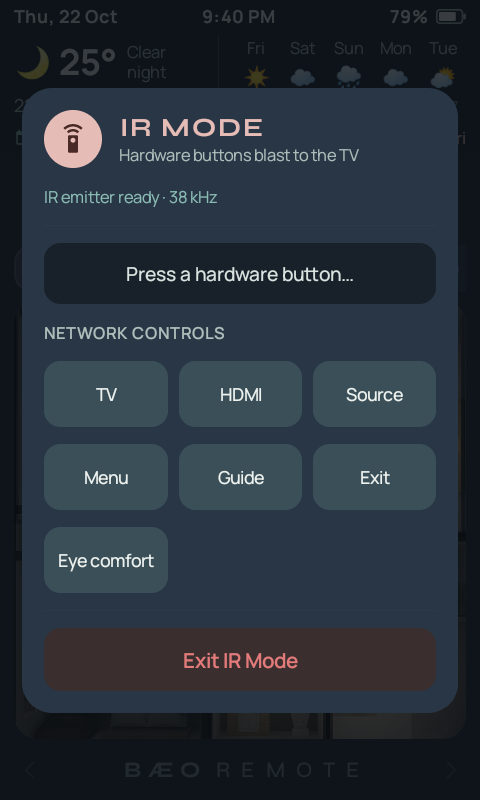 | 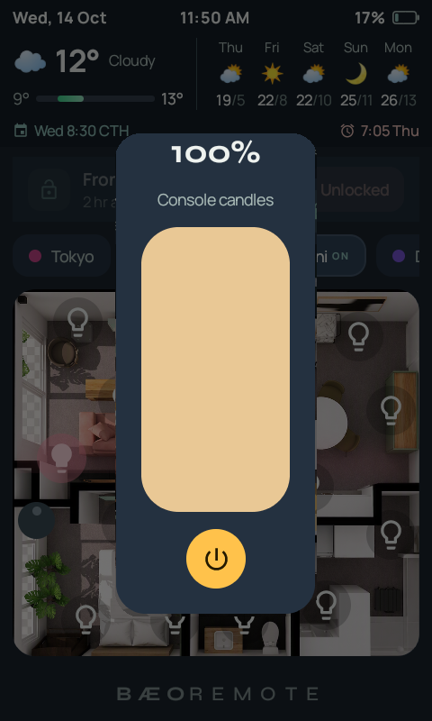 | 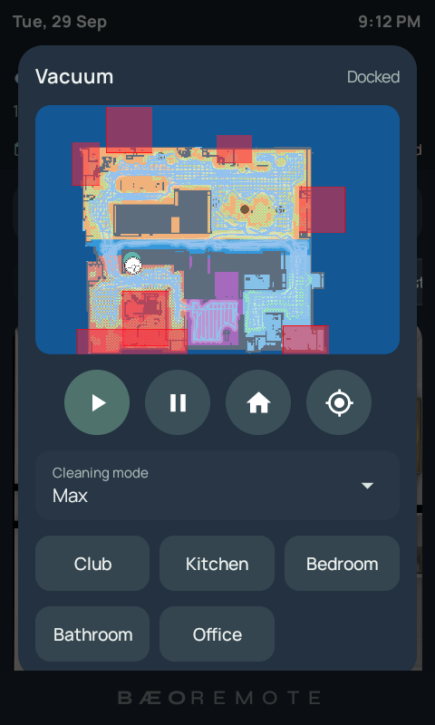 |
| **Washer Done Alert** | **Alarm Ringing** | **Alarm Snoozed** |
| 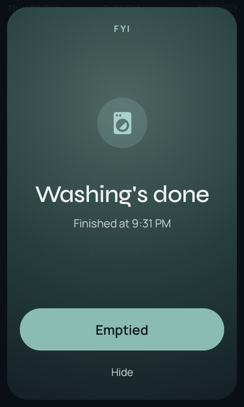 | 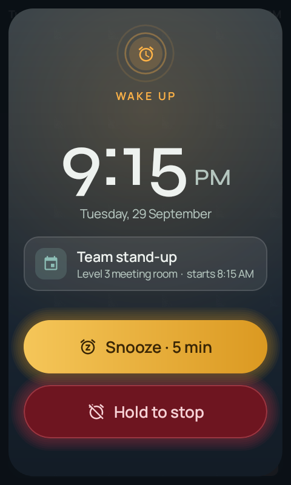 | 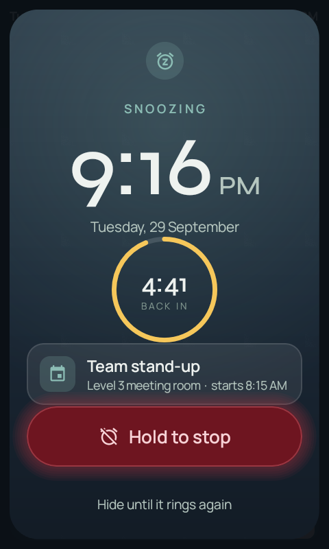 |

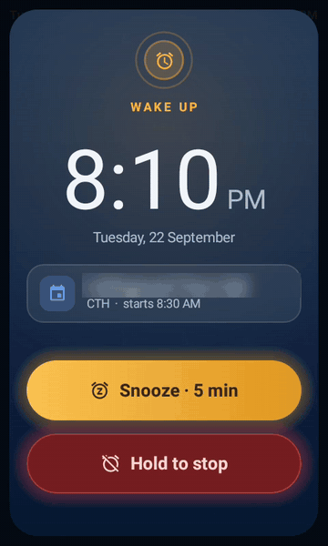

---

## Architecture & System Design

Astrion is built for the resource-constrained MediaTek MT6580 SoC (4× ARM Cortex-A7 @ 1.3GHz, Mali-400 GPU, 1 GB RAM, Android 8.1 Go Edition):

* **Architecture:** Modernized **MVI (Model-View-Intent)** with Kotlin Coroutines, `StateFlow`, and `SharedFlow`. ViewModels (`DashboardViewModel`, `PowerViewModel`, `InputViewModel`) decouple state cleanly from the view layer.
* **Dependency Injection:** Lightweight **Koin** DI (`ViewModelModule`, `RepositoryModule`, `NetworkModule`, `HardwareModule`).
* **Design System (Bæo Design System v2.0):** One theme API, `AstrionTheme`, backed by the design system's CompositionLocals. Tokens are grounded in Porter's Paints swatches: Yacht Race for the surfaces, Hailstorm and Gunmetal Grey for accents and selected state, Baby Doll for attention (warnings, the next alarm, mute). Red is for errors only, and warm amber for lights that are on. Every colour and font size is a token (`ui/theme/`); `ThemeLiteralsTest` fails on a literal in the cards, and `AstrionDesignSystemTest` checks there are no duplicate tokens and that text and accents meet WCAG AA (4.5:1).
* **Fast TV App Launches:** Colored hardware keys (`CUSTOM_1` – `CUSTOM_3`) trigger native non-blocking `media_player.select_source` intents, launching Netflix, Plex, and ABC iview in under 150ms without blocking Home Assistant's ADB connection.
* **Selective WebSocket State Publishing:** `HaClient` updates its internal store in-place for all entities while filtering Compose snapshot writes and `StateFlow` emissions to observed UI, screensaver, and alarm/alert entities—eliminating main-thread recomposition and GC churn from chatty background sensors.
* **Dock & Off-Dock Power Management:** Asymmetric dock/undock debounce (`dock_debounce_seconds: 2`, `undock_debounce_seconds: 15`) absorbs pogo-pin contact drops on the dock while allowing the display, `rmm/stream` radar subscription, and entity filter to sleep cleanly when undocked.
* **Boot Persistence & Launcher Recovery:** Configured with `RECEIVE_BOOT_COMPLETED`, automatic `BootReceiver` relaunch, and `.HomeAlias` default launcher locking so the remote always boots straight into Astrion even after low-battery shutdowns.
* **RTC Drift Prevention:** Root `astrion_timesync` init daemon synchronizes the system clock and hardware RTC from the local Home Assistant HTTP `Date:` header on boot and every 15 minutes (or on demand as root: `setprop debug.astrion.timesync 1`) without requiring external internet NTP access.

---

## Build and Install

### Prerequisites
* JDK 17
* Android SDK (API 27+)
* Remote build script or Gradle: `/home/bae/Documents/claude/remote-build.sh ./gradlew assembleRelease`

### Setup Instructions

1. **Add your Home Assistant details:** Copy `secrets.properties.example` to `secrets.properties` (gitignored):
   ```properties
   haUrl=http://<your-ha-ip>:8123
   haToken=<long-lived access token>
   ```

2. **Build the release APK:**
   ```bash
   /home/bae/Documents/claude/remote-build.sh ./gradlew assembleRelease
   ```

3. **Install over ADB and compile ahead-of-time (AOT):**
   ```bash
   adb install -r app/build/outputs/apk/release/app-release.apk
   adb shell cmd package compile -m speed -f com.custom.astrion
   ```

4. **Set as Default Launcher and Lock Permissions:**
   ```bash
   adb shell pm enable com.custom.astrion/.HomeAlias
   adb shell cmd package set-home-activity com.custom.astrion/.HomeAlias
   adb shell appops set com.custom.astrion WRITE_SETTINGS allow
   adb shell settings put global ntp_polling_interval 1800000
   ```

---

## Configuration

Layout, buttons, and entities are managed via `/sdcard/astrion/dashboard.json`:

| File | Role |
|---|---|
| `/sdcard/astrion/dashboard.json` | Live configuration on the remote |
| `device/config/dashboard.json` | Bundled default configuration inside the APK |
| `/sdcard/astrion/device.json` | This remote's own settings (battery sensor name), laid over dashboard.json; see `docs/POWER.md` |
| `/sdcard/astrion/floorplan.png` | Apartment floorplan image |

Push new configurations over ADB (or `device/install.sh --layout <ip>`); the app reloads within a second:
```bash
adb push device/config/dashboard.json /sdcard/astrion/dashboard.json
```

`trusted_tls_hosts` (top level, optional) lists LAN hosts whose HTTPS certificate is accepted without a name match, for album art from a server reached by IP whose certificate names something else (Plex by IP). Every other host gets the normal check.

---

## Physical Hardware Button Mapping

The HA100 physical button matrix:

| Physical Key | Android Keycode | Default Mapping / Action |
|---|---|---|
| `LIGHT` | 134 | Navigate to **BÆOREMOTE** (Main Page) |
| `CURTAIN` | 135 | Navigate to **BÆOVISION** (TV Page) |
| `SCENE` | 136 | Navigate to **BÆOSOUND** (Media Page) |
| `AC` | 137 | Navigate to **BÆOLIVING** (Climate Page) |
| `CUSTOM_1` (Red) | 138 | Launch Netflix (`com.netflix.ninja`) |
| `CUSTOM_2` (Green) | 139 | Launch Plex (`com.plexapp.android`) |
| `CUSTOM_3` (Blue) | 140 | Launch ABC iview (`au.net.abc.iview`) |
| `CUSTOM_4` (Yellow) | 141 | Run TV Ambient Show script |
| `VOLUME_UP` / `DOWN` | 24 / 25 | Adjust volume + trigger floating Volume OSD |
| `MUTE` | 91 / 164 | Toggle mute + trigger floating Volume OSD |
| `MENU` (☰) | 82 | Press: IR Mode (Samsung TV by infrared). **Hold: help guide** |
| `VOICE` (🎤) | 133 | Trigger Home Assistant Assist satellite session |
| `D-PAD` & `CENTER` | 19–23 | TV navigation & select commands |

---

## Project Structure

All application source code is located under `app/src/main/java/com/custom/astrion/`:

```
com.custom.astrion/
├── AstrionApp.kt            # App entry point, Koin DI & Registry initialization
├── MainActivity.kt          # Window host, gesture router, lifecycle management
├── BootReceiver.kt          # Automatic relaunch on system boot & recovery
├── viewmodel/               # DashboardViewModel, PowerViewModel, InputViewModel
├── di/                      # Koin Dependency Injection modules
├── ha/                      # Home Assistant WebSocket & HTTP client
├── cards/                   # CardRegistry and implementation renderers
├── config/                  # AppConfigRepository and reactive config loader
├── ui/                      # Dashboard, PageName, Screensaver, VolumePopup, Theme
├── input/                   # HardwareKeys, KeyDispatcher, and hotkey routing
├── power/                   # Battery state machine, dock detection, motion wake
├── voice/                   # Home Assistant Assist satellite audio streaming
└── ir/                      # Built-in IR blaster transmitter & Samsung codes
```

---

## Notes & Licensing

* **Licence:** MIT ([`LICENSE`](LICENSE)). Manrope and Syne fonts are used under the SIL Open Font License ([`licenses/`](licenses)).
* **Wireless ADB Security:** The HA100 firmware runs `userdebug`. See [`device/README.md`](device/README.md) for network lockdown instructions.
* **Plex for Android TV:** Deep linking uses standard Android intents supported by classic Plex for Android TV (10.x).
